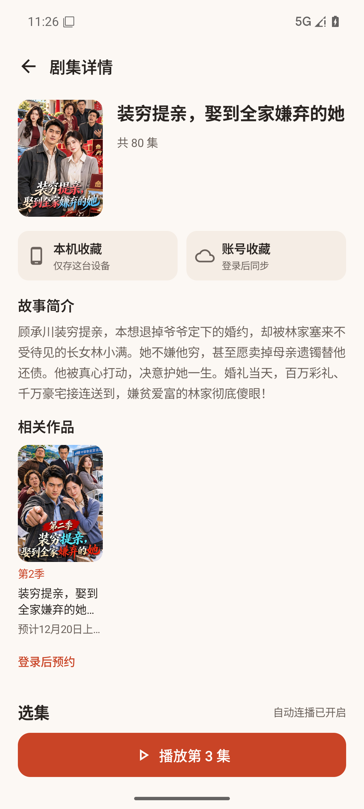
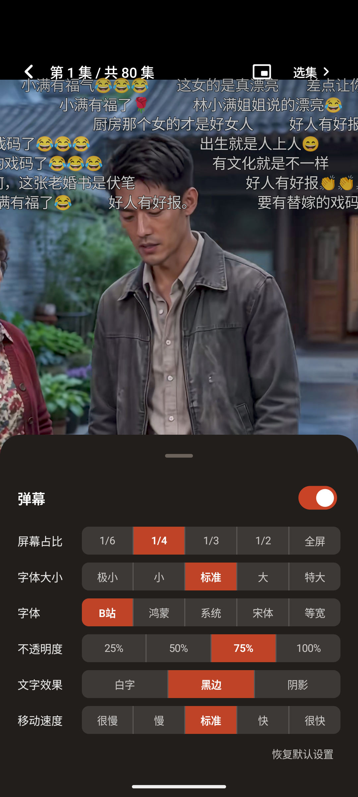

> [!IMPORTANT]
> **本仓库是第三方修改分支（带弹幕），不是官方版。**
>
> 基于上游 [`OOIUa/hongguo-android`](https://github.com/OOIUa/hongguo-android) **v0.7.33** 的 GPL-3.0 源码。上游自 0.7.32 起已内置官方弹幕，本分支在此基础上增加了**弹幕字体切换**，并做了去商标化与独立分发配置：
>
> - 应用名「弹幕剧场」· 包名 `com.hongguo.android.dm` · **可与上游版并存**
> - 签名与上游不同，**不能与上游版互相覆盖安装**
> - 与红果 / 抖音 / 番茄小说及其关联公司无关，未获授权，不代表其立场；接口靠逆向官方客户端工作，官方改版即可能失效
> - 分发合规、签名、发布步骤与风险清单见 [DISTRIBUTION.md](DISTRIBUTION.md)
> - 主分发仓库：`sssdex/tanmu-juchang`；`sssdex/hongguo-android` 是同步的 fork 镜像，用于跟踪上游

<div align="center">

# 弹幕剧场

**带弹幕的短剧客户端（第三方修改分支）**

Kotlin + Jetpack Compose + Media3 的原生 Android 客户端，请求、媒体处理、缓存与播放均在本机完成。<br>本分支在上游官方弹幕之上补了**字体切换**：内置思源黑体（默认，B站弹幕观感）与 HarmonyOS Sans，另有系统 / 宋体 / 等宽可选；屏幕占比、字号、不透明度、文字效果、滚动速度均可调，暂停即停、倍速同步。

[](#下载与安装) [](LICENSE) [](DISTRIBUTION.md)

[**下载 APK**](../../releases/latest) · [分发说明](DISTRIBUTION.md) · [源码构建](#源码构建) · [上游项目](https://github.com/OOIUa/hongguo-android)

</div>

## 下载与安装

从本仓库的 [Releases](../../releases/latest) 下载最新 APK。Android **8.0 / API 26** 及以上。

> 从 `0.7.33-dm24` 起内置两套中文字体（思源黑体、HarmonyOS Sans），APK 因此增大约 25 MB；字体许可与来源见 [第三方通知](THIRD_PARTY_NOTICES.md)。

每个 Release 的说明都写明：对应的源码 tag、APK 的 SHA-256、包名与签名指纹。下载后可以这样核对：

```bash
sha256sum <下载到的文件>.apk
```

> **与上游版的关系**：本包的包名（`com.hongguo.android.dm`）和签名都与上游版不同。
>
> - 可以和上游版**同时安装**；
> - **不能**覆盖安装到上游版上，也不能让上游版覆盖本包（会报 `INSTALL_FAILED_UPDATE_INCOMPATIBLE`）；
> - 本分支内部升级：签名不变时可以覆盖安装，保留收藏、历史与续播位置；
> - 卸载或清除应用数据会删除本机记录，属于有损操作，不能当作无损升级。

> 上游本体客户端与 iOS 版见 [OOIUa/hongguo-android](https://github.com/OOIUa/hongguo-android) 与 [OOIUa/hongguo-ios](https://github.com/OOIUa/hongguo-ios)。

## 界面预览

> 以下截图取自上游文档，界面与功能与本分支一致，但截图里的应用名与图标仍是上游品牌，本分支已改为「弹幕剧场」与自绘标记。

### 本分支实机截图

模拟器 AVD `hg36`（Pixel 6 轮廓，Android 16，1080×2400）实测，`0.7.33-dm24`：

<table>
  <tr>
    <th align="center">首页（弹幕剧场）</th>
    <th align="center">播放页 · 弹幕滚动</th>
    <th align="center">弹幕设置面板</th>
  </tr>
  <tr>
    <td></td>
    <td></td>
    <td></td>
  </tr>
</table>

弹幕参数：屏幕占比 5 档（1/6 … 全屏）、字号 5 档、**字体 5 档（B站 = 内置思源黑体，默认；鸿蒙 = 内置 HarmonyOS Sans；系统 / 宋体 / 等宽用系统字体族）**、不透明度 4 档、文字效果（白字 / 黑边 / 阴影）、移动速度 5 档；跟随播放位置滚动，暂停即停、倍速同步；换字体、换字号时正在飞的弹幕不清空，按新字宽重新排轨道；换集/换剧/重启后沿用；画中画不显示；弹幕层在手势层之下，不影响单击显隐、双击暂停与横滑。

<table>
  <tr>
    <th align="center">暖白精修 · 首页</th>
    <th align="center">沉浸暗场 · 首页刷剧</th>
    <th align="center">内容卡片 · 首页</th>
  </tr>
  <tr>
    <td></td>
    <td></td>
    <td></td>
  </tr>
  <tr>
    <th align="center">发现与筛选</th>
    <th align="center">主题样式</th>
    <th align="center">我的</th>
  </tr>
  <tr>
    <td></td>
    <td></td>
    <td></td>
  </tr>
</table>

截图来自 v0.7.23 的 Android 模拟器实拍，内容列表随上游更新。

## 功能一览

| 功能 | 说明 |
| --- | --- |
| 弹幕 | 播放页右下角「弹」开关与设置入口：屏幕占比、字号、字体（B站 = 思源黑体 / 鸿蒙 = HarmonyOS Sans / 系统 / 宋体 / 等宽）、不透明度、文字效果、移动速度；跟随播放位置滚动，暂停即停、倍速同步，转屏后按已滚比例续锚 |
| 首页与续看 | 本机最新观看记录一键续播；推荐（猜你喜欢，登录后按本人账号推荐）、热度、最新短剧和漫剧榜单，支持继续翻页；沉浸暗场上下滑动自动试看第 1 集 |
| 发现与搜索 | 浏览短剧、漫剧、AI 剧，按上游提供的条件筛选；从首页或发现进入独立搜索页 |
| 竖屏播放 | 上划下一集、下划上一集，也可打开选集面板跳转；竖屏保留状态栏，横屏为全屏 |
| 详情页演员表 | 展示演员头像、姓名与饰演角色，点按查看简介（随上游 0.7.33 合入） |
| 横屏全屏 | 顶栏显示剧名与集数，点击剧名从左侧展开详情；收藏、小窗、选集在顶栏右侧，选集与收藏从右侧半屏滑出；底部为时间、进度条与播放按钮，进度条上方不放其他内容，避免误触 |
| 播放控制 | 轻点显示或隐藏控件，双击任意位置暂停 / 继续；长按画面进入 2 倍速后左右拖动调整进度（中间显示目标时间，松手跳转）；拖动进度条、缓冲进度显示、播放失败重试 |
| 长按临时加速 | 播放中长按视频左侧或右侧临时以2倍速播放，同时隐藏界面文字和按钮；松手、取消、离开页面后恢复原速度和界面，不改变保存的倍速 |
| 清屏播放 | 播放中双指外拉只显示视频画面；轻点屏幕、双指内捏或返回键恢复 |
| 六档倍速 | 0.5×、0.75×、1×、1.25×、1.5×、2×，点「倍速」在按钮上方竖向展开，自动记住选择 |
| 连播与预加载 | 可分别开关自动连播、下一集预加载，末集不循环 |
| 片单与续播 | 本机与红果账号切换来源；本机保存收藏、观看历史、集数与集内位置，支持单条移除与清空 |
| 个人红果账号 | 官网网页登录、扫码与手机号验证码入口；官网和手机云账号验证分开，失败可复制脱敏诊断 |
| 账户片单 | 仅在手机业务身份通过验证后读取收藏、最近 50 部历史及预约，与本机记录分开；待上线的预约显示预计上线日期 |
| 可选进度上报 | 仅已确认的手机云账号可用，默认关闭；实际跨设备结果需本人验收 |
| 边播边缓存 | 对支持的片源按需下载与处理，不兼容时回退完整缓存播放 |
| 应用内更新 | 手动 / 启动检查，支持直连、两条加速线路及自动切换 |
| 界面主题 | 暖白精修、沉浸暗场、内容卡片三套主题，各有独立的首页、发现/剧场、片单、详情与我的页面布局，点选即时生效；可在系统深色模式时自动使用沉浸暗场；底栏可选经典或悬浮玻璃 |

首页按热度、上新及榜单展示内容；收藏和观看历史各最多保存 **200 部**，两份列表独立管理。

推荐会在本机按匿名与不同账号分别保留最近 **540 部**已推荐作品，刷新或重开应用后继续去重；超过窗口的旧作品仍可能再次出现。片单读取失败时保留原数据、暂停写入，可在本机片单页重试读取。

## 快速上手

底部导航为「首页 / 发现 / 片单 / 我的」，搜索从首页或发现的搜索栏进入独立页面。

1. 安装后从「首页」或「发现」选剧，也可点击搜索栏输入剧名。
2. 进入详情，选择集数开始播放；首页「继续观看」或「片单 → 本机 → 历史」可继续上次的集数与位置。
3. 播放中轻点画面显示或隐藏控件，双击任意位置暂停 / 继续；长按画面进入 2 倍速后左右拖动，或拖动进度条跳转，上下滑动切集；点击底部剧名打开详情，返回后接着播放（横屏点顶部剧名从左侧展开详情）；右下角「倍速」在上方展开速度列表；播放中长按视频左侧或右侧可临时2倍速，松手恢复之前的速度。
4. 详情中分别提供本机与账号收藏操作；播放器点击「收藏」（横屏为顶栏星标），在面板中选择「本机收藏」或「红果账号收藏」。到「片单」切换来源，查看对应历史、收藏；预约仅在红果账号来源显示。详情页「相关作品」里的待上线作品显示预计上线日期，可直接预约。
5. 到「我的 → 播放设置」调整自动连播、下一集预加载和启动检查更新。
6. 到「我的 → 账号与隐私」登录个人账号；只有一部手机时选择「在本机打开官网登录」，待页面加载后点「打开官网登录窗口」，自行完成官方验证后点上方「完成登录」。也可在另一台设备的红果 App 中扫码确认。

若显示“官网已登录，手机云账号未接通”，官网会话已加密保留，可直接重试账号资料；点击“复制诊断信息”可提供不含凭据与身份值的结构摘要。此状态不读取或写入手机云片单。

应用需要联网访问上游内容源，无需填写服务器地址。切到后台会停止播放与预加载。

## 在线更新

打开「**我的 → 检查更新**」即可手动检查。开启启动检查后，每次重新启动应用会在后台检查一次，有兼容的新版本才弹窗；没有新版或检查失败时保持安静。普通前后台切换和旋转屏幕不会重复检查，手动检查不受启动开关限制。

发现新版后，点击「下载更新」才开始下载。下载完成会校验文件大小、SHA-256、包名、版本、最低系统要求与签名，再交给 Android 系统确认安装。首次更新可能需要允许本应用安装来自此来源的应用。

更新窗口可选择「自动切换」「GitHub 直连」「加速线路 1」「加速线路 2」，选择保存在本机。自动模式依次尝试三条线路；取消下载会停止本次任务。安装包使用相同的完整性与签名校验。

发布源为本仓库的 [GitHub Releases](https://github.com/sssdex/tanmu-juchang/releases)，更新清单为 [update.json](https://github.com/sssdex/tanmu-juchang/releases/latest/download/update.json)。只有更高的 `versionCode` 才会提示更新。下载与安装均由用户操作确认。本分支构建时通过 `-PupdateRepository=sssdex/tanmu-juchang` 绑定更新源，未绑定则不检查更新。

## 播放、缓存与本机数据

- **渐进播放**：常见非碎片 CENC MP4 使用 Range 按需取块并在本机处理，首帧无需等待整集下载。不支持此路径的媒体会回退为整集下载、处理后播放；实际效果取决于片源、编码、封装与网络。
- **本机记录**：收藏、历史、播放偏好与缓存保存在应用私有目录，无需广泛文件访问权限。历史在实际渲染首帧后记录，准备失败不会记为已观看。
- **账号记录**：个人会话和账户片单加密保存在本机，退出或切换账号隔离数据。原本机记录不会自动上传；详情的账号收藏入口和播放器面板中的「红果账号收藏」属于独立的云端操作。短信可能需要官网验证，收藏与跨设备续播需用本人账号核对。
- **缓存用途**：用于播放加速，可能随会话结束或空间策略被清理，不作为永久离线保存。目前仅支持前台播放，未提供后台播放服务或批量离线下载。

<details>
<summary>预加载与缓存额度</summary>

下一集预加载仅在应用处于前台、开关开启、当前集已渲染首帧且缓冲至少 5 秒后启动。除索引与样本探测外，额外预热最多 512 KiB 的文件前段；关闭开关或切到后台后停止预加载。

渐进缓存与完整缓存各有独立的 512 MiB 额度。不完整的渐进缓存会在会话关闭时清除，缓存也可能按空间策略淘汰。调整倍速保留当前播放位置和暂停状态，并在切集、连播及再次打开应用时继续使用。

</details>

## 源码构建

### 环境准备

- JDK **17 或 21**。
- Android SDK **Platform 36**，通过 `ANDROID_HOME` 或本机 `local.properties` 中的 `sdk.dir` 指定 SDK 位置。
- 仓库已包含 **Gradle Wrapper**；首次构建需要联网下载 Gradle 与依赖。也可使用 Android Studio 打开项目。

```bash
git clone https://github.com/sssdex/tanmu-juchang.git
cd tanmu-juchang
```

Windows / PowerShell：

```powershell
.\gradlew.bat :app:assembleDebug :app:testDebugUnitTest :app:lintDebug
```

Linux / macOS：

```bash
chmod +x gradlew
./gradlew :app:assembleDebug :app:testDebugUnitTest :app:lintDebug
```

APK 产物：`app/build/outputs/apk/debug/HGMini-v0.7.33-dm24-debug.apk`（文件名带版本号，由 `appVersionName` 决定；版本号规则见 `app/build.gradle.kts` 顶部）。

有 Android 设备或模拟器时，可运行设备测试：

```powershell
.\gradlew.bat :app:connectedDebugAndroidTest
```

Linux / macOS 使用 `./gradlew` 执行同一任务。联网用例会访问真实上游内容并下载视频，可用性与耗时取决于网络和内容源。

> 当前发布包沿用既有测试签名。自行构建时自动生成的其他测试密钥无法覆盖现有安装。发布须保留同一密钥并核对 [公开证书指纹](release-signing.sha256)；构建发布资产、对应源码和更新清单的步骤见 [发布指南](RELEASING.md)。

### 项目结构

```text
app/src/
├── main/
│   ├── java/com/hongguo/android/  # Compose 界面、播放、收藏历史与在线更新
│   ├── java/com/hongguo/api/      # Java 请求、签名与媒体处理核心
│   └── assets/                   # 上游参数与许可证通知
├── test/                         # JVM 回归测试
└── androidTest/                  # Android 设备与播放验证
scripts/prepare-release.ps1       # 发布资产生成脚本
```

### 验证范围

[验证记录](VALIDATION.md) 包含构建、静态检查、模拟器回归及覆盖更新的数据保留记录。实体手机、Android 8–15 设备及全部编码 / MP4 布局尚未全面验证，账号功能的实际登录与同步结果需由本人核对。

## 常见问题

**需要部署后端或安装 Node.js / FFmpeg 吗？**

不需要。请求、签名、媒体处理、缓存与播放在 APK 内执行，手机仍需联网访问内容源。

**为什么有些剧集需要等待较久？**

支持渐进播放的片源可以边播边缓存；不兼容时会先下载整集并处理。网络、上游响应与媒体格式都会影响准备时间，不能保证所有片源都能立即起播。

**能离线保存剧集或同步收藏吗？**

缓存仅用于播放加速，不提供永久离线保存。登录个人账号后可读取云端片单，并主动开启本次观看进度上报。本机旧记录不会自动上传，历史与预约按固定批次读取。卸载或清除应用数据会删除本机记录。

**播放提示“匿名播放设备注册失败”或“播放服务连续返回空响应”？**

2026-11-20 起，上游取源接口发生变化：`player/v1` 的 v5 POST 和旧的签名 `video_tab` GET 都只返回 HTTP 200 + 空正文，所有旧路径都会得到 `EMPTY_RESPONSE`，表现为「播放服务连续返回空响应，请稍后重试或选择其他集」。0.7.32 起改为先把 `video_tab` 按 v5 签名、以**无正文 GET** 请求（只带 `x-khronos` / `x-helios` / `x-medusa`，正文摘要为空正文的 MD5），这是目前可用的取源路径，旧路径保留为回退。若哪天再次全空，优先检查本仓库是否已跟进上游的新取源改动。

**怎么切换界面主题？**

打开「我的」，点右上角齿轮或「设置」，进入「主题样式」即可切换，选择即时生效并会记住。三套主题的页面布局不同：暖白精修为经典布局，沉浸暗场首页可上下滑动刷剧，内容卡片以热度榜和瀑布流为主。主题选择只在首次打开 0.7.4 时出现一次，选“暂不选择”会保留当前主题。播放页始终为深色，三套主题共用。

**更新下载失败怎么办？**

在更新窗口切换线路重试，或从本文的 APK 下载链接手动覆盖安装。保留旧版应用数据，避免先卸载。

**如何反馈问题？**

请在 [Issues](https://github.com/sssdex/tanmu-juchang/issues) 提供应用版本、Android 版本、手机型号、复现步骤与错误截图。播放问题可补充剧名和集数，方便定位。

## 来源与许可证

本 Android 应用按 **GPL-3.0-only** 分发。协议与媒体核心参考 [sunnysky123/hongguo-web](https://github.com/sunnysky123/hongguo-web)，其中部分实现注明来自 [jackotom/hongguo-drama](https://github.com/jackotom/hongguo-drama)；保留原有来源注释及 MIT / GPL 通知。

完整条款、来源版本与改动说明见 [LICENSE](LICENSE) 和 [第三方通知](THIRD_PARTY_NOTICES.md)。发布 APK 时应同时提供该版本对应的完整源码与构建文件。

## Star History

<a href="https://www.star-history.com/#sssdex/tanmu-juchang&Date">
  <picture>
    <source media="(prefers-color-scheme: dark)" srcset="https://api.star-history.com/svg?repos=sssdex/tanmu-juchang&type=Date&theme=dark" />
    <source media="(prefers-color-scheme: light)" srcset="https://api.star-history.com/svg?repos=sssdex/tanmu-juchang&type=Date" />
    
  </picture>
</a>
